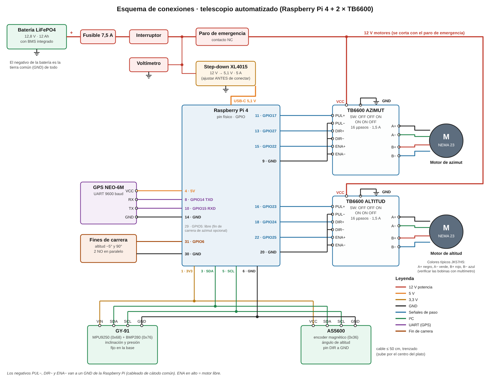

# Circuito · esquema de conexiones y prueba en banco



`esquema.svg` y `esquema.png` se generan con `python3 generar_esquema.py`. El mismo esquema
es la **Figura 3 del artículo**.

**Dónde va cada cosa físicamente:**
- **Caja de control impresa**, atornillada a la base: Raspberry Pi, TB6600, step-down, GY-91 y GPS.
- **Panel de energía impreso**, junto a la batería: paro de emergencia, interruptor,
  voltímetro y fusible.

Ver [`montura/LEEME.md`, §6](../montura/LEEME.md#6-dónde-va-la-electrónica).

> ⚠️ **Seguridad**
> - Conecta y desconecta cables **siempre con el interruptor general apagado**.
> - **Nunca desconectes un motor con el TB6600 energizado:** el pico de voltaje daña el driver.
> - Ajusta el *step-down* a 5,1 V con el multímetro **antes** de conectar la Raspberry Pi.
>   Con 12 V en su entrada de 5 V, la Raspberry Pi se quema al instante.
> - La batería LiFePO4 se carga solo con su cargador LiFePO4 de 14,6 V.

---

## 1. Tabla de conexiones, cable por cable

Los pines son los **números físicos** del conector de 40 pines de la Raspberry Pi
(el pin 1 es el de la esquina, junto a la ranura de la microSD).

### Alimentación

| Desde | Hacia | Cable |
|---|---|---|
| Batería **+** | Fusible 7,5 A → interruptor general | 18 AWG rojo |
| Interruptor | **Voltímetro +** y **entrada + del step-down** | 18 AWG rojo |
| Interruptor | **Paro de emergencia** (contacto NC) → **VCC** de los dos TB6600 | 18 AWG rojo |
| Batería **−** | GND de los TB6600, entrada − del step-down y voltímetro − | 18 AWG negro |
| Step-down **salida 5,1 V** | Raspberry Pi por **USB-C** (cable USB-C de buena calidad) | — |

El paro de emergencia corta **solo los motores**: la Raspberry Pi sigue encendida y no se
corrompe la microSD.

### Drivers TB6600 (señales, cableado de cátodo común)

| Señal | TB6600 azimut | TB6600 altitud |
|---|---|---|
| PUL+ | Pin **11** (GPIO17) | Pin **16** (GPIO23) |
| DIR+ | Pin **13** (GPIO27) | Pin **18** (GPIO24) |
| ENA+ | Pin **15** (GPIO22) | Pin **22** (GPIO25) |
| PUL−, DIR−, ENA− (unidos) | Pin **9** (GND) | Pin **20** (GND) |

El software mantiene **ENA en bajo** para que el motor tenga fuerza. Al cerrar el servidor
lo pone en alto y el motor queda libre.

### Sensores

| Componente | Pin del módulo | Raspberry Pi |
|---|---|---|
| **GPS NEO-6M** | VCC | Pin **4** (5 V) |
| | RX | Pin **8** (GPIO14 · TXD) |
| | TX | Pin **10** (GPIO15 · RXD) |
| | GND | Pin **14** (GND) |
| **GY-91** (fijo en la base) | VIN | Pin **1** (3,3 V) |
| | SDA | Pin **3** (GPIO2) |
| | SCL | Pin **5** (GPIO3) |
| | GND | Pin **6** (GND) |
| **AS5600** (en el eje de altitud) | VCC | Pin **1** (3,3 V), compartido con el GY-91 |
| | SDA / SCL | Pin **3** / Pin **5**, el mismo bus I²C |
| | GND | Pin **6** (GND) |
| | DIR | GND (fija el sentido de medición) |
| **Fines de carrera de altitud** (2 microswitches NO en paralelo) | COM | Pin **30** (GND) |
| | NO | Pin **31** (GPIO6) |
| Ventilador de la Raspberry Pi (opcional) | + / − | Pin **2** (5 V) / Pin **34** (GND) |

**Notas:**
- **GPS:** el TX del GPS va al RX de la Raspberry Pi y viceversa (se cruzan).
- **I²C:** el cable al AS5600 sube por el centro del plato. Usa un cable trenzado de máximo
  50 cm; a más distancia el bus falla.
- **GPIO5 (pin 29):** queda libre por si más adelante se agrega un fin de carrera en azimut.

---

## 2. Configuración de los TB6600 (interruptores DIP)

| Switch | S1 | S2 | S3 | S4 | S5 | S6 |
|---|---|---|---|---|---|---|
| **Posición** | OFF | OFF | ON | ON | ON | OFF |
| Significado | 16 micropasos (3200 pulsos por vuelta) | | | 1,5 A (pico 1,7 A) | | |

> Esta es la tabla más común en los TB6600, pero algunos clones cambian el orden.
> **Confirma con la etiqueta impresa en tu driver** y busca la fila "16 / 3200" y la
> columna "1,5 A".

## 3. Identificar las bobinas del motor

El NEMA 23 tiene 4 cables, dos por bobina. Con el multímetro en continuidad o resistencia:
- **Los dos cables de una misma bobina** marcan unos **1 Ω** entre sí. Esa bobina va a
  **A+ y A−**.
- Los otros dos forman la segunda bobina, que va a **B+ y B−**.
- **Colores típicos de los JK57HS:** A+ negro, A− verde, B+ rojo y B− azul.
- **Si el motor gira al revés,** no cambies cables: pon `"invertido": true` en ese eje del
  `config.json`.

---

## 4. Armado y prueba en banco (sin la montura)

Haz cada paso y **no avances hasta que funcione**. Los comandos se ejecutan en la Raspberry
Pi, dentro de la carpeta `prototipo/`.

| # | Qué conectar | Comando de prueba | Resultado esperado |
|---|---|---|---|
| 1 | Batería → fusible → interruptor → step-down (sin la Raspberry Pi) | Multímetro en la salida | Ajustar el tornillo hasta **5,1 V** |
| 2 | Raspberry Pi por USB-C | Encender | Arranca sin el aviso de bajo voltaje (rayo amarillo) |
| 3 | GY-91 y AS5600 (I²C) | `python -m telescopio.prueba_banco i2c` | Aparecen 0x36, 0x68 y 0x76 |
| 4 | Imán frente al AS5600 | `python -m telescopio.prueba_banco encoder` | "imán correcto" y el ángulo cambia al girar el imán |
| 5 | GY-91 sobre una mesa plana | `python -m telescopio.prueba_banco nivel` | Inclinación total < 1° |
| 6 | GPS, junto a una ventana o al aire libre | `python -m telescopio.prueba_banco gps --segundos 300` | Aparece "FIX" con tu latitud y longitud |
| 7 | Fines de carrera | `python -m telescopio.prueba_banco fin-carrera` | Al pulsar cada uno: "ACTIVADO" |
| 8 | TB6600 de azimut + motor + paro de emergencia | `python -m telescopio.prueba_banco motor az --grados 90` | El eje del motor gira 90° y vuelve |
| 9 | Igual con el de altitud | `python -m telescopio.prueba_banco motor alt --grados 90` | Igual |
| 10 | Paro de emergencia | Pulsarlo durante la prueba 8 | El motor se detiene y queda libre |
| 11 | Todo junto | `python -m telescopio.servidor --config config.json` | La interfaz web responde desde el celular |

En las pruebas 8 y 9 **no uses `--config`**: sin él, el software asume acople directo y el
eje del motor gira exactamente los grados pedidos. Con `--config config.json` aplicaría la
reducción de la montura (14:1 o 5:1) y el motor daría 14 o 5 veces más vueltas. Marca el eje
con cinta para comprobar que **vuelve exactamente al mismo punto**: si no vuelve, pierde
pasos y hay que bajar `vel_max` o subir la corriente.

## 5. Antes de la prueba 3: activar I²C y el puerto serie

```bash
sudo raspi-config   # Interface Options → I2C: Enable
                    # Interface Options → Serial Port: login shell NO, hardware SÍ
sudo reboot
pip install smbus2  # lectura del GY-91 y del AS5600
```

> El script de instalación automática (paso 5 del plan) hará todo esto por ti.
