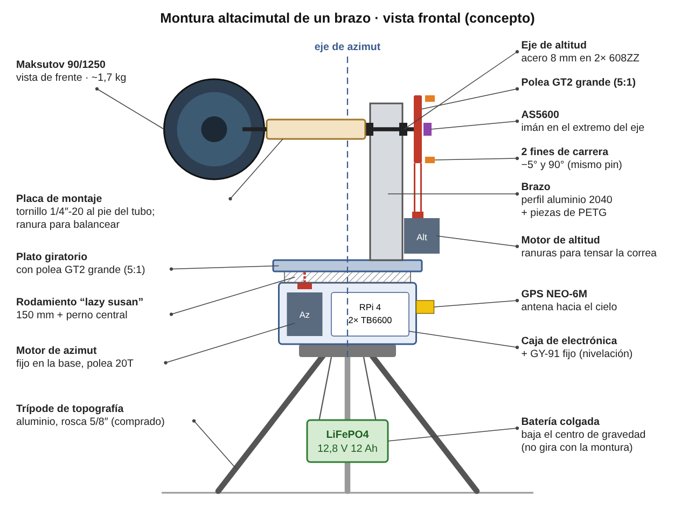
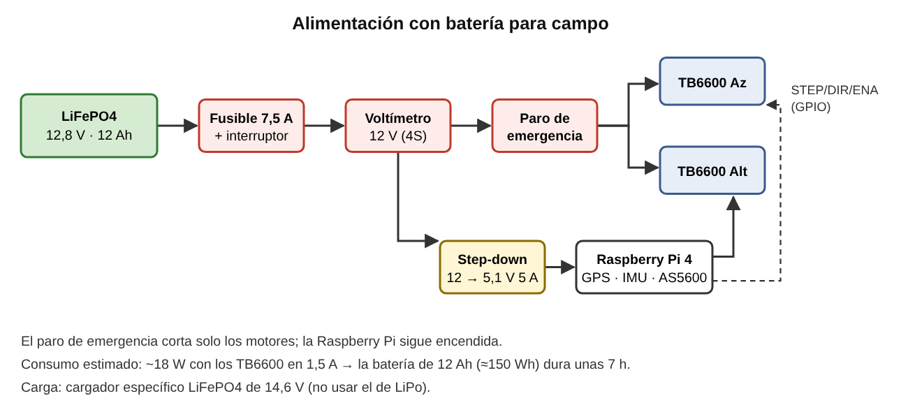

# Paso 3 · Telescopio, diseño de la montura y baterías

Decisiones de hardware para un prototipo **portátil, a batería y para observar planetas en
el campo**. Los precios son **estimaciones aproximadas** y deben cotizarse en Ecuador.

---

## 1. Telescopio recomendado: Maksutov-Cassegrain de 90 mm

**Primera opción:** Sky-Watcher **Skymax 90** (solo el tubo óptico, o "OTA"), o un
equivalente como el Celestron C90 Mak o el Bresser Maksutov 90/1250.

| Criterio | Maksutov 90/1250 ✅ | Maksutov 102/1300 | Refractor 70/700 |
|---|---|---|---|
| Tamaño de los planetas | Bueno: f/13,9, aumentos altos con oculares baratos | Algo mejor | Regular, con aberración cromática |
| Peso del tubo | **~1,6–1,8 kg** | ~2,1 kg | ~1,5 kg |
| Largo | **~28 cm** | ~30 cm | ~70 cm |
| Facilidad para una montura impresa en 3D | **Muy alta:** compacto y fácil de balancear | Alta | Baja: el tubo largo hace palanca y vibra |
| Precio aproximado en EE. UU. (sin envío) | ~USD 200–260 | ~USD 299 (solo el tubo) | ~USD 100–150 (kit completo) |

**Por qué el Maksutov 90:**
- **Planetas:** con su focal de 1250 mm, el ocular de 25 mm da 50× y el de 10 mm da 125×.
  Se ven las bandas de Júpiter y los anillos de Saturno.
- **Es corto y liviano:** un tubo de 28 cm y 1,7 kg pone muy poca carga sobre las piezas de
  PETG y los motores, y se balancea fácilmente sobre el eje de altitud.
- **Normalmente trae** buscador de punto rojo, diagonal y dos oculares, y se fija con una
  **zapata de rosca 1/4″-20**, la misma de las cámaras. La placa de montaje del diseño usa esa
  rosca, así que no hace falta comprar una cola de milano.
- **Si se importa:** caja de ~3 kg y menos de USD 400. Puede entrar por courier en la
  categoría 4×4; verifica las condiciones vigentes del régimen y la tasa.

**Dato de diseño para el artículo: campo visual frente a la precisión necesaria**

| Configuración | Campo visual | Error máximo para ver el planeta |
|---|---|---|
| Ocular de 25 mm (50×, ~52° aparente) | ≈ 1,0° (62′) | < ~30′ |
| Cámara Raspberry Pi Camera Module 3 en foco primo (sensor de 6,45 × 3,63 mm) | ≈ 17,7′ × 10′ | **< ~5′** |

Esto justifica cuantitativamente la reducción 5:1, que da 1,35′ por micropaso, y la
corrección del error con IA. Con acople directo (6,75′ por paso) el planeta ni siquiera
entraría de forma confiable en el campo de la cámara.

---

## 2. Diseño de montura recomendado: altacimutal de un brazo

### Idea general

1. **No imprimir el trípode.** Unas patas de PLA o PETG se flexionan y arruinan la
   precisión. Conviene usar un **trípode de topografía de aluminio** (rosca 5/8″-11), del
   tipo que se usa con niveles y estaciones totales. Es barato, muy rígido y se consigue en
   ferreterías y tiendas de topografía. **Se imprime solo la cabeza (la montura).** En el
   artículo esto se describe como "montura de diseño propio sobre un trípode comercial".
2. **Base fija:** adaptador a la rosca 5/8″, el motor de azimut en posición vertical y la
   caja con la electrónica (Raspberry Pi, 2 TB6600, *step-down* y fusible). El **GY-91 va
   fijo a la base** para medir la nivelación del trípode, y el **GPS se monta afuera**, mirando
   al cielo.
3. **Eje de azimut:** un **rodamiento giratorio tipo "lazy susan" de 150 mm** con un perno
   central M8/M10 para centrar. Debajo del plato giratorio va una **polea GT2 grande de 100
   dientes impresa**, y el motor fijo le transmite el giro con una polea de 20 dientes (5:1).
4. **Brazo:** **perfil de aluminio 2040** (unos 30 cm), unido con piezas de PETG. Es mucho
   más rígido que un brazo totalmente impreso. El **motor de altitud va abajo**, para mantener
   bajo el centro de gravedad, con ranuras para tensar la correa.
5. **Eje de altitud:** varilla de acero de 8 mm sobre **2 rodamientos 608ZZ**. De un lado va
   la placa del telescopio y del otro la polea GT2 de 100 dientes (5:1). En el extremo del eje
   va un **imán diametral para el AS5600**, que mide el ángulo real de altitud.
6. **Placa de montaje:** tornillo 1/4″-20 a la zapata del Maksutov, con una **ranura para
   deslizar el tubo** hasta que quede balanceado. Si está balanceado, el motor casi no hace
   fuerza y el tubo no cae al cortar la corriente.
7. **Fines de carrera:** **2 en altitud** (−5°, para no chocar con la base, y 90°), conectados
   **en paralelo al mismo pin** (GPIO 6). En azimut no se pone interruptor: el software limita
   el giro a ±270° y el cable del motor de altitud se deja con holgura (1,5 vueltas).
8. **Batería colgada entre las patas del trípode.** Hace de contrapeso, baja el centro de
   gravedad y no gira con la montura.

### Parámetros de fabricación

| Elemento | Recomendación |
|---|---|
| Material | **PETG**. El PLA se deforma al sol o dentro de un auto caliente |
| Piezas estructurales | 4–5 perímetros, relleno del 40–60 % (gyroid) |
| Poleas GT2 de 100 dientes impresas | Diámetro primitivo = 100 × 2 mm / π ≈ **63,7 mm**. Imprimir con capas de 0,12–0,16 mm |
| Correa cerrada | Largo ≈ 2C + π(D + d)/2 + (D − d)²/4C, donde C es la distancia entre ejes. Con C = 120 mm sale ≈ 365 mm. Comprar la longitud estándar más cercana y ajustar C con las ranuras |
| Reducción | 20T → 100T = **5:1**, es decir **1,35′ por micropaso** y hasta ~20°/s de velocidad de GoTo |

> 📌 **Tu diseño actual:** si me compartes capturas o los archivos (STL, STEP o el
> proyecto de Fusion/SolidWorks/Onshape), lo comparo con este concepto y te digo qué
> conservar y qué cambiar, en lugar de empezar de cero.

---

## 3. Baterías para observar en el campo

### Batería recomendada: **LiFePO4 de 12,8 V y 12 Ah** (≈ 150 Wh) con BMS integrado

- **Es compatible:** el voltaje está dentro del rango del TB6600 (9–42 V), entre 14,6 V con
  carga completa y ~10 V cuando corta el BMS.
- **Es segura:** a diferencia de la LiPo, la química LiFePO4 no se incendia con facilidad.
  Esto importa en demostraciones con público y es un argumento para el artículo.
- **Dura toda la noche** (ver el consumo abajo) y aguanta miles de ciclos de carga.
- **Necesita un cargador LiFePO4 específico de 14,6 V.** No se carga con el de LiPo.

### Consumo estimado

| Componente | Potencia |
|---|---|
| Raspberry Pi 4 | 3–6 W |
| 2 × NEMA 23 con TB6600 a **1,5 A** (energizados todo el tiempo para seguir el objeto) | ~10–12 W |
| GPS, GY-91 y AS5600 | < 0,5 W |
| Pantalla de 5″ (si se usa) | ~2 W |
| **Total típico** | **~15–20 W**, es decir **~7 h** con 12 Ah |
| Con los TB6600 a 2,5 A | ~35 W, es decir ~4 h |

➡️ **Configura los TB6600 en 1,5 A.** Con el telescopio balanceado y la reducción 5:1 sobra
torque (~0,95 N·m en el motor × 5 en el eje), y la batería rinde casi el doble.

**Alternativa más barata:** batería de plomo-ácido sellada de 12 V y 7 Ah (las de alarmas),
por ~USD 20. Pesa más (~2 kg) y rinde ~4 h. Sirve para empezar las pruebas.

**La batería LiPo 2S que ya compraste:** no sirve para los motores. Se puede guardar como
respaldo para alimentar solo la Raspberry Pi por ~1 h con un *step-down*, o no usarla.

---

## 4. Lista de compras definitiva

| Grupo | Ítem | Cant. | Aprox. USD |
|---|---|---|---|
| **Telescopio** | Maksutov 90/1250 (Skymax 90 o equivalente), solo el tubo | 1 | 200–260 + envío |
| **Montura** | Trípode de topografía de aluminio (rosca 5/8″) | 1 | 35–60 |
| | Rodamiento giratorio "lazy susan" de 150 mm | 1 | 4–6 |
| | Rodamientos 608ZZ | 4 | 3–5 |
| | Varilla de acero de 8 mm (20 cm) o perno M8 | 1 | 2–4 |
| | Perfil de aluminio 2040 (30 cm) + tuercas en T | 1 | 6–10 |
| | Polea GT2 de 20 dientes con **agujero de 8 mm**, ancho 6 mm | 2 | 5–8 |
| | Correa GT2 cerrada de 6 mm (largo según el diseño) | 2 | 5–8 |
| | Tornillería M3/M5/M8 y tornillo 1/4″-20 | — | 6–10 |
| | Filamento PETG | 1 kg | 20–28 |
| | Fines de carrera (microswitch con palanca) | 2 | 1–3 |
| | Imán diametral para el AS5600 (si no venía con el módulo) | 1 | 1–2 |
| **Energía** | Batería LiFePO4 de 12,8 V y 12 Ah con BMS | 1 | 45–70 |
| | Cargador LiFePO4 de 14,6 V | 1 | 15–25 |
| | *Step-down* a 5,1 V y 5 A (XL4015) + cable USB-C | 1 | 5–8 |
| | Portafusible con fusible de 7,5 A + interruptor | 1 | 4–6 |
| | Voltímetro o indicador para 12 V (LiFePO4 4S) | 1 | 3–5 |
| | Pulsador de paro de emergencia (tipo hongo) | 1 | 3–5 |
| | Cable de 18 AWG (alimentación), cable de 4 hilos de 22 AWG (motores), borneras y jumpers | — | 8–12 |
| **Raspberry Pi** | MicroSD de 32 GB (A1) | 1 | 6–10 |
| | Disipadores + ventilador o case ventilado | 1 | 5–8 |
| **Recomendado** | Raspberry Pi Camera Module 3 + adaptador de 1,25″ impreso | 1 | 25–35 |
| | Nivel de burbuja circular | 1 | 1–3 |

**Total aproximado sin el telescopio: USD 210–330.** Con el telescopio: USD 410–590.

**Para bajar el costo:** usar un trípode de madera o de cámara robusto que ya tengas, una
batería de plomo-ácido de 12 V y 7 Ah, y un brazo de madera contrachapada en lugar del perfil
de aluminio.

---

## 5. Cambios en el software

- `config.ejemplo.json` queda con **reducción 5:1**, **velocidad máxima de 900 micropasos/s**
  (~20°/s) y **sin fin de carrera en azimut**.
- Pendiente para el paso de integración: leer el GY-91 (inclinación y presión para la
  refracción) y el AS5600 (ángulo real de altitud), y registrarlos junto con cada apuntado.
