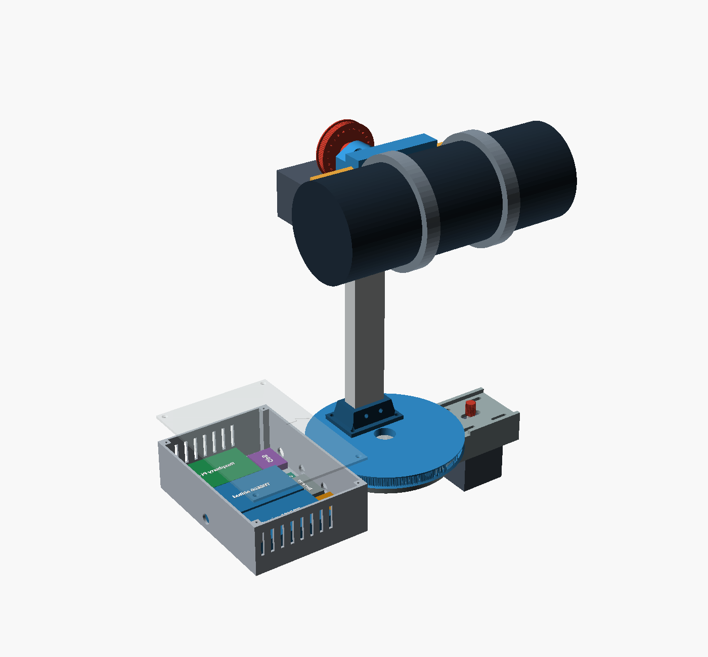
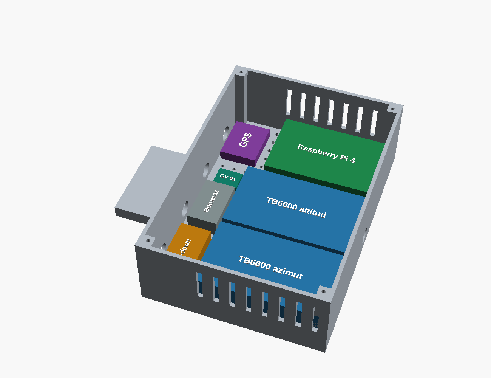

# Montura altacimutal imprimible · guía de impresión y armado

Montura de un brazo, **universal para telescopios livianos (≤ 3 kg)** gracias a la
cola de milano estándar **Vixen**, con transmisión por correas GT2:

| Eje | Transmisión | Resolución (16 micropasos) | Velocidad de GoTo |
|---|---|---|---|
| Azimut | Corona impresa de 280 dientes ← polea de 20T = **14:1** | **0,48′** por micropaso | ~16°/s (2000 micropasos/s) |
| Altitud | Polea impresa de 100 dientes ← polea de 20T = **5:1** | **1,35′** por micropaso | ~20°/s (900 micropasos/s) |

| Archivo | Para qué |
|---|---|
| `montura.scad` | Diseño **paramétrico** en OpenSCAD (gratis, [openscad.org](https://openscad.org)). Todas las medidas son variables al inicio del archivo |
| `stl/*.stl` | Piezas listas para el *slicer* (Cura, PrusaSlicer, Creality Print), ya orientadas para imprimir |
| `generar_stl.sh` | Regenera los STL si cambias alguna medida |

---

## 1. Antes de imprimir: mide lo que compraste

Abre `montura.scad` y revisa las variables marcadas con **(MEDIR)**:

| Variable | Valor por defecto | Qué medir |
|---|---|---|
| `nema_eje_largo` | 21 mm | Largo del eje del motor desde la brida |
| `polea20_largo`, `polea20_cubo` | 16 y 7 mm | Largo total de la polea GT2 de 20T y de su cubo |
| `lazy_lado`, `lazy_alto` | 102 y 8 mm | Lado y alto del rodamiento giratorio de 4″ |
| `vx_base` | 44 + 0,6 mm | Ancho mayor de la barra Vixen de tu telescopio |
| `perfil_largo` | 300 mm | Largo del perfil 2040 (ver la tabla de telescopios, §5) |

Si cambias algo, ejecuta `./generar_stl.sh` (o exporta desde OpenSCAD con F6 → *Export STL*).

## 2. Primero, la pieza de prueba (10 minutos)

Imprime **`prueba_gt2.stl`**, que contiene un aro de 100 dientes y un segmento de la corona
de 280 dientes. Pon un trozo de correa GT2 encima:
- **Encaja sin forzar y sin juego:** puedes imprimir todo.
- **Queda floja o no entra:** ajusta la escala horizontal en el *slicer* (p. ej. 100,5 % o
  99,5 %) o la compensación de agujeros, y vuelve a probar.

## 3. Piezas a imprimir (PETG)

| # | Archivo | Cant. | Orientación (ya viene así) | Soportes | Material aprox. |
|---|---|---|---|---|---|
| 1 | `base_fija.stl` | 1 | Cara superior sobre la cama | No | ~145 g |
| 2 | `soporte_motor_azimut.stl` | 1 | De costado | No | ~62 g |
| 3 | `plato_giratorio.stl` | 1 | Boca abajo (cara superior sobre la cama) | No | ~168 g |
| 4 | `zocalo_brazo.stl` | 1 | Base sobre la cama | No | ~27 g |
| 5 | `cabezal_altitud.stl` | 1 | De costado (un rodamiento hacia la cama) | No; el túnel del perfil es un puente de 40 mm | ~45 g |
| 6 | `polea_altitud.stl` | 1 | Ala sobre la cama | No | ~29 g |
| 7 | `soporte_motor_altitud.stl` | 1 | De pie | No | ~63 g |
| 8 | `montura_vixen.stl` | 1 | Mordazas sobre la cama | No; el canal es un puente de 45 mm | ~76 g |
| 9 | `barra_vixen.stl` | 1 (opcional) | Cara ancha sobre la cama | No | ~66 g |
| 10 | `caja_control.stl` | 1 | Fondo sobre la cama | No | ~167 g |
| 11 | `tapa_caja.stl` | 1 | Cara exterior sobre la cama | No | ~59 g |
| 12 | `panel_energia.stl` | 1 | Frente sobre la cama | No | ~72 g |
| 13 | `tapa_panel.stl` | 1 | Plana | No | ~26 g |
| — | `prueba_gt2.stl` | 1 | — | No | ~8 g |

**Total: unos 1 020 g de PETG**, así que conviene comprar **2 rollos de 1 kg** (sobra para
reimprimir alguna pieza). Todas las piezas caben en una cama de
220 × 220 mm (Ender 3 o similar).

**Configuración recomendada:** capa de 0,2 mm (0,16 mm en las poleas), **5 perímetros**,
relleno **gyroid del 40 %**, 5 capas superiores e inferiores. Para las piezas grandes
(base y plato), usa *brim* para que no se levanten las esquinas.

## 4. Tornillería y piezas compradas

| Dónde | Qué |
|---|---|
| Base ↔ trípode | 1 tuerca hexagonal **5/8″-11 UNC** (se inserta desde arriba en la base) |
| Base ↔ soporte del azimut | 3 tornillos M5×25 con cabeza cilíndrica y 3 tuercas M5 |
| Motores ↔ soportes | 8 tornillos M5×20 y 8 tuercas M5 (los agujeros de la brida del NEMA 23 son pasantes) |
| Lazy susan ↔ base y plato | 8 tornillos M4×12 o autorroscantes. **Se taladran al armar**, usando el lazy susan como plantilla |
| Zócalo ↔ plato | 4 tornillos M5×25 y 4 tuercas M5 (embutidas bajo el disco) |
| Perfil 2040 ↔ plato y cabezal | **Roscar con macho M5** los agujeros centrales de ambos extremos del perfil. 2 tornillos M5×20 abajo y 2 M5×50 arriba |
| Perfil ↔ zócalo, cabezal y soporte de altitud | 8 tornillos M5×10 y 8 tuercas en T para perfil 2040 |
| Eje de altitud | Varilla de acero de **8 mm × 160 mm**, 2 rodamientos **608ZZ** |
| Polea y mordaza ↔ eje | 4 prisioneros M3×8 con 4 tuercas M3. **Lima un plano en el eje** donde aprietan |
| Apriete de la mordaza Vixen | 2 tornillos M5×30 con 2 tuercas M5 (mejor con perillas) |
| Barra Vixen impresa ↔ telescopio | Tornillo **1/4″-20** (pie del telescopio o anillas) o M6, y 2 tornillos de tope M5 en los extremos |
| Correas GT2 de 6 mm cerradas | **Azimut: 600 mm** (o 610). **Altitud: 280 mm** (o 300) |
| AS5600 | Imán diametral de 6 × 2,5 mm pegado en la punta del eje (lado de la polea) |
| Fines de carrera | 2 microswitches en el cabezal; un tornillo M3 en uno de los agujeros de la polea (cada 15°) hace de leva |
| Caja de control ↔ base | 3 tornillos M5×25 y 3 tuercas M5 (embutidas bajo la lengüeta) |
| Placas dentro de la caja | 4 tornillos autorroscantes M2.5×6 (Raspberry Pi) y ~12 autorroscantes M3×8 (TB6600, step-down, borneras, GY-91, GPS) |
| Tapas de la caja y del panel | 8 tornillos autorroscantes M3×10 |
| Cables | 8 prensaestopas **PG7** (5 en la caja, 3 en el panel) y una correa de velcro de 25 mm |

**Distancia entre ejes según la correa**

| Correa | Distancia entre ejes |
|---|---|
| Azimut, 600 mm | 121,9 mm desde el centro (las ranuras admiten de 116 a 133) |
| Azimut, 610 mm | 128,3 mm |
| Altitud, 280 mm | 75,7 mm (se ajusta deslizando el soporte por el perfil) |
| Altitud, 300 mm | 86,2 mm |

Fórmula: L ≈ 2C + π(D + d)/2 + (D − d)²/4C, con los diámetros primitivos D = 178,25 mm
(280T), 63,66 mm (100T) y d = 12,73 mm (20T).

## 5. Compatibilidad con telescopios

La montura acepta **cualquier telescopio con barra cola de milano tipo Vixen** (la de la
mayoría de los telescopios pequeños). Si el telescopio no tiene barra:

| El telescopio tiene… | Cómo se monta |
|---|---|
| Barra Vixen | Directo en la mordaza (pieza 8) |
| Pie con rosca 1/4″-20 (Maksutov 90, catalejos terrestres) | Pie atornillado a la **barra impresa** (pieza 9) o a una barra comercial |
| Anillas sin barra | Anillas atornilladas a la barra (1/4″ o M6) |
| Solo el tubo | Comprar un par de anillas del diámetro del tubo |

**Límites:**
- **Peso:** ≤ **3 kg** en total (tubo, buscador, diagonal y ocular). Con más peso, el PETG
  flexiona y el error de apuntado aumenta.
- **Balance:** desliza la barra en la mordaza hasta que el tubo quede quieto en cualquier
  ángulo **sin** los motores energizados.
- **Largo:** al apuntar al cenit, la parte trasera del tubo (más la diagonal y el ocular)
  baja por debajo del eje. Elige el largo del perfil según el telescopio:

| Telescopio (ejemplos) | Largo trasero desde el eje* | Perfil 2040 | Altitud máxima |
|---|---|---|---|
| Maksutov 90–102, refractores 70/400–80/400 | ≤ 30 cm | **300 mm** | 90° |
| Refractor 70/700, 80/600 | ≤ 47 cm | **500 mm** | 90° |
| Más largo | — | 500 mm | Limitar con `alt.max_grados` en `config.json` |

\* La mitad del tubo más ~10 cm de diagonal y ocular, con el tubo balanceado.

Si cambias de telescopio, ajusta `alt.max_grados` en la configuración del software. Si
cambias de focal, recuerda que el campo visual cambia.

## 6. ¿Dónde va la electrónica?

| Unidad | Dónde | Qué contiene |
|---|---|---|
| **Caja de control** (piezas 10 y 11) | Atornillada a la **base fija**, del lado opuesto al motor de azimut. **No gira** con la montura | Raspberry Pi 4, 2 × TB6600, step-down, borneras, **GY-91** (al ir fija a la base mide la nivelación del trípode) y **GPS** (la antena se pega bajo la tapa: el PETG deja pasar la señal) |
| **Panel de energía** (piezas 12 y 13) | Colgado con velcro de una pata del trípode, junto a la batería | Paro de emergencia, interruptor general, voltímetro y fusible en línea |
| **Batería LiFePO4** | Colgada entre las patas del trípode (bolsa o bandeja) | — |

**Recorrido de los cables:**
- **Motor de altitud, AS5600 y fines de carrera:** bajan por el brazo, pasan por el agujero
  central del plato (Ø 25 mm), el lazy susan y el agujero de la base, y entran por debajo
  de la base a la caja por los prensaestopas de la pared interior. Deja una holgura de
  1,5 vueltas para el giro de ±270°.
- **Motor de azimut:** va por debajo de la base, del soporte del motor a la caja.
- **Alimentación:** un cable de 4 hilos de 18 AWG (12 V lógica, 12 V motores y 2 GND) va
  del panel de energía al prensaestopas de la pared exterior de la caja.

**Ventilación:** las ranuras laterales quedan frente a los TB6600 y a la Raspberry Pi. Con
1,5 A los drivers se entibian, pero no necesitan ventilador. Para la Raspberry Pi se
recomienda un disipador.

**Orientación al norte:** la tapa tiene grabada una flecha **N** que apunta hacia la
montura. Al instalar, gira el trípode para que la flecha (y el motor de azimut) apunte al
norte, con el tubo paralelo a esa dirección y el objetivo hacia el norte. Luego pulsa
"Referenciar".

## 7. Orden de armado

1. **Base:** inserta la tuerca 5/8″ desde arriba y atornilla el soporte del azimut con 3 M5.
2. **Motor de azimut:** colócalo bajo el soporte (eje hacia arriba) y pon la polea de 20T
   con el cubo hacia abajo, al ras de la placa.
3. **Lazy susan:** atorníllalo a la base, centrado. Taladra con él como plantilla.
4. **Plato:** atornilla el zócalo (4 M5) y el perfil por debajo (2 M5). Monta el plato sobre
   el lazy susan.
5. **Correa de azimut:** pásala por la corona y la polea, y tensa deslizando el motor en las
   ranuras. Debe sonar como una cuerda grave al pulsarla.
6. **Cabezal:** encájalo arriba del perfil (2 M5 verticales) y coloca los 2 608ZZ.
7. **Eje de altitud:** atraviesa los rodamientos con la varilla de 8 mm. De un lado va la
   **polea** (cubo hacia el cabezal) y del otro la **mordaza Vixen**. Aprieta los prisioneros
   sobre los planos limados.
8. **Motor de altitud:** atornilla el soporte a la cara del perfil del lado de la polea,
   coloca la correa de 280 mm y tensa deslizando el soporte hacia abajo.
9. **Telescopio:** colócalo en la mordaza y balancéalo.
10. **Caja de control:** atorníllala a la base (3 M5), fija las placas según el
    [esquema de conexiones](../circuito/LEEME.md) y pasa los cables por los prensaestopas.
11. **Referencia:** con el trípode nivelado, orienta la flecha **N** de la tapa al norte y
    pulsa "Referenciar" en la interfaz web.
