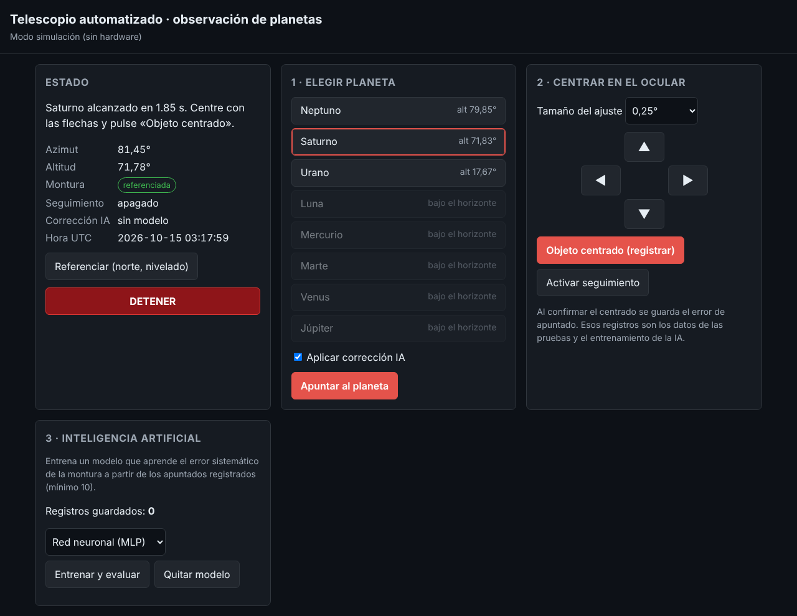

# Prototipo · software del telescopio automatizado (v0.1)

Software que corre en la **Raspberry Pi 4**. Calcula la posición de los planetas, mueve la
montura altacimutal con los drivers TB6600, sirve la interfaz web y registra cada apuntado
para medir la precisión y entrenar la corrección por IA.

Funciona también en una PC en **modo simulación**, sin hardware, para avanzar mientras se
arma la parte mecánica.



## Arquitectura

```
Navegador (PC / celular)  ──HTTP──▶  servidor.py (FastAPI)
                                          │
                                     sistema.py  ── orquesta el flujo GoTo → centrado → registro
              ┌──────────────┬───────────┼─────────────┬──────────────┐
          astro.py       montura.py  correccion.py   registro.py     gps.py
       (Skyfield, DE421)  (ángulos ↔ pasos,  (IA: lineal / MLP,  (CSV con cada    (NEO-6M,
                           límites)       validación cruzada)  apuntado)       NMEA)
                              │
                         motores.py  ── rampa de aceleración, MotorSimulado / MotorTB6600 (GPIO)
```

| Módulo | Qué hace |
|---|---|
| `config.py` | Sitio (por defecto, Portoviejo), parámetros de cada eje (micropasos, reducción, pines, límites) |
| `astro.py` | Altitud y azimut aparentes de Mercurio, Venus, la Luna, Marte, Júpiter, Saturno, Urano y Neptuno |
| `motores.py` | Perfil trapezoidal de velocidad para no perder pasos; pulsos STEP/DIR/ENA; fines de carrera |
| `montura.py` | Conversión de grados a pasos, camino más corto en azimut, límites mecánicos, movimiento simultáneo de los 2 ejes |
| `correccion.py` | **Componente de IA**: aprende el error sistemático de apuntado (regresión lineal frente a red neuronal MLP), validación cruzada y prueba de Wilcoxon |
| `registro.py` | CSV `datos/registro_apuntado.csv`: los datos crudos para el artículo |
| `gps.py` | Ubicación y hora desde el GPS (la Raspberry Pi no tiene reloj con batería) |
| `sistema.py` | Flujo completo: GoTo, ajuste fino, confirmación del centrado, seguimiento, entrenamiento de la IA |
| `servidor.py` + `static/index.html` | API REST e interfaz web accesible (botones grandes, `aria-live`, adaptada a celular) |

## Uso en una PC (simulación)

```bash
cd prototipo
python3 -m venv .venv && source .venv/bin/activate     # en Windows: .venv\Scripts\activate
pip install -r requirements.txt
python -m telescopio.servidor                            # abrir http://localhost:8000
```

La primera vez se descargan las efemérides `de421.bsp` (~17 MB) en `datos/`.

Pasos en la interfaz: **Referenciar** → elegir un planeta visible → **Apuntar** → centrar con
las flechas → **Objeto centrado (registrar)**. Con 10 registros o más se puede **entrenar la IA**.

## Uso en la Raspberry Pi

1. Copiar `config.ejemplo.json` a `config.json` y ajustar los pines, los micropasos (según los
   switches del TB6600) y la **reducción** de la transmisión.
2. Activar el puerto serie para el GPS (`raspi-config` → Interface → Serial: login shell
   **no**, hardware **sí**).
3. Ejecutar `python -m telescopio.servidor --config config.json`.
4. Desde cualquier dispositivo de la misma red, abrir `http://<ip-de-la-pi>:8000`.

### Conexiones previstas (BCM)

| Señal | Eje azimut | Eje altitud |
|---|---|---|
| PUL+ (STEP) | GPIO 17 | GPIO 23 |
| DIR+ | GPIO 27 | GPIO 24 |
| ENA+ | GPIO 22 | GPIO 25 |
| Fin de carrera (a GND) | GPIO 5 | GPIO 6 |
| PUL− / DIR− / ENA− | GND | GND |

GPS NEO-6M: TX → GPIO 15 (RXD), RX → GPIO 14 (TXD), VCC 5 V, GND.
⚠️ Los TB6600 necesitan **9–42 V**; ver `docs/01-diagnostico-articulo.md` §5.

## Pruebas automáticas

```bash
python -m pytest
```

Las pruebas cubren el perfil de velocidad, la cinemática, los límites, los fines de carrera,
la IA con datos sintéticos, la API y un flujo completo simulado (15 apuntados, entrenamiento
y GoTo corregido).
